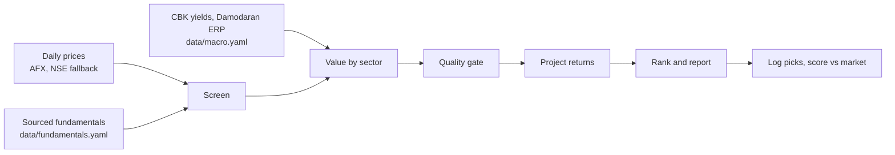

# NSE market agent

An autonomous, rule-based agent that screens Nairobi Securities Exchange (Kenya) stocks, values them, flags undervalued
names, projects return ranges and tracks how its past picks performed. It runs on GitHub Actions and publishes a weekly
report to GitHub Pages.

**Live dashboard:** https://ronaldndirangu.github.io/nse-market-agent/ (daily brief at `daily.html`, weekly report at
`weekly.html`, all past reports at `archive.html`)

> **Not financial advice.** This project is a research tool built from public data and fixed rules. Figures can be
> wrong, late or incomplete. Verify everything against company filings and speak to a licensed adviser before investing.

## How it works

Every number comes from deterministic Python code. No AI or paid API runs anywhere in the pipeline, and the report is
rendered from a template.



1. **Screen.** A stock needs a fresh price, average daily turnover of at least KES 1m, at least 3 sourced annual
   periods, positive EPS and no suspension.
2. **Value.** Cost of equity is `ke = (10y KES yield - sovereign default spread) + beta x mature ERP + country risk
   premium`, which is about 20% at beta 1. Beta comes from 3 years of weekly returns against an equal-weight index of
   the universe. Models:
   - Banks: justified P/B `(ROE - g) / (ke - g)`.
   - Dividend payers: Gordon growth `D1 / (ke - g)`.
   - Everyone: sector-relative P/E and P/B (when at least 3 peers exist) and the Graham number.
   - Growth `g` is sustainable growth `ROE x retention`, capped at 7%.
3. **Agree.** A stock counts as undervalued only when at least half of its models (and at least 2) put fair value 15%
   or more above the price.
4. **Quality gate.** Piotroski F-score (banks swap the margin and liquidity signals for cost-to-income and core
   capital trends), Altman Z'' for non-financials,
   NPL ratio level and trend for banks, and profit-warning keywords in NSE announcements over the last 180 days.
5. **Project.** Annual return `= net dividend yield + (1 + g) x (V/P)^(1/3) - 1 - round-trip costs / 3`, using 1.82%
   trading costs per side and 5% dividend withholding tax. Bear and bull cases use the low and high fair values and
   shift growth by 2 points.
6. **Rank.** A weighted composite of z-scores: 50% margin of safety, 30% quality, 20% momentum.
7. **Buy rule.** `BUY` means undervalued, passes quality, and the base-case return beats the net 91-day T-bill yield
   by at least 5 points. `PICK` is undervalued without clearing that hurdle. `WATCH` means the models agree but a screen
   or quality check failed.

All thresholds live in [`data/settings.yaml`](data/settings.yaml).

### High confidence undervalued and risk profile

A stock is flagged **High confidence undervalued** only when all four gates pass:

| Gate | Rule |
|---|---|
| Valuation | At least 3 valuation models put fair value 15% or more above the price |
| Quality | Quality gate passes with a score of 0.67 or more |
| Screen | Liquid, fresh price, at least 3 sourced periods, positive EPS, not suspended |
| Return | Base-case annual return beats the Buy hurdle |

When nothing qualifies, the brief lists the closest candidates and the gates they miss.

Every stock also gets a **risk profile**. Seven factors are each rated Low, Moderate or High from fixed thresholds:
volatility, beta, liquidity, downside (bear case), valuation spread (fair high over fair low), balance sheet (bank NPL
ratio or Altman Z) and events (profit warnings, suspensions). Overall risk is High when the balance sheet or events
factor is High or two factors are High, Moderate when one factor is High or three are Moderate, and Low otherwise.
Risk never changes the flag; use it to size a position. Missing inputs are listed as not assessed.

Point-in-time backtest of the flag since 2017: it fired 28 times, only on COOP, EQTY and KCB. At 12 months no flagged
pick lost money, but they trailed the equal-weight universe by 3.5% on average (N=18); at 6 months they beat it by
4.5% (N=23). The plain Buy tier did better at 12 months (+8.9%). The flag is a stricter filter, and its short record does not yet beat
the Buy tier.

## Schedule

| Workflow | When (UTC) | What it does |
| --- | --- | --- |
| Daily brief | 13:00 Mon to Fri (16:00 EAT) | Records closing prices, values and ranks every stock, writes the daily brief (top 5 tiered Buy, Watch or Avoid, with reasons and what changed), appends the prediction ledger in `data/rankings/`, deploys Pages, and comments on the `daily-alert` issue only on a material change |
| Results watch | 13:30 Mon to Fri | Detects results announcements, extracts figures by rule, opens a review PR |
| Weekly report | 14:00 Friday | Values and ranks, runs simulation, backtest, scorecard and retrospective, commits `reports/`, deploys Pages, opens an issue |
| Monthly scorecard | 15:00 on the 1st | Scores every logged pick against the market, refreshes the retrospective and the weight test, and opens a `tune-weights` PR only when new weights win out of sample. Weights never change without your merge |
| CI | Every push and PR | Runs the test suite |

Every workflow also runs on demand from the Actions tab. GitHub pauses schedules in a public repo after 60 days with no
activity; the daily and weekly commits keep it active.

## Data and integrity

| Data | Source | File |
| --- | --- | --- |
| Daily prices, volume | [afx.kwayisi.org/nse](https://afx.kwayisi.org/nse/), fallback [nse.co.ke](https://www.nse.co.ke/) | `data/prices/*.csv` |
| NASI | Month-end closes from 2016 in [CMA](https://www.cma.or.ke/) quarterly statistical bulletins (CBK weekly bulletin for the latest month), plus the AFX index page daily when reachable | `data/nasi.csv`, sources in `data/nasi_sources.csv` |
| Dividends | Company notices, CMA bulletins and annual reports, from 2016 | `data/dividends.yaml` |
| Bonus issues, splits, rights, mergers | NSE and company notices | `data/corporate_actions.yaml` |
| Fundamentals | Company annual and interim reports | `data/fundamentals.yaml` |
| T-bills, CBR, inflation | [Central Bank of Kenya](https://www.centralbank.go.ke/) | `data/macro.yaml` |
| Equity and country risk premium | [Damodaran](https://pages.stern.nyu.edu/~adamodar/) | `data/macro.yaml` |
| Announcements | NSE announcements feed | `data/market/` |

Rules:

- Fundamentals are never invented. Every period in `data/fundamentals.yaml` carries a `source_url`, a reporting period
  and a publication date. A missing figure stays missing and appears under **Data gaps** in the report.
- No LLM extracts fundamentals. The results watcher parses filings with fixed rules (bank results follow the CBK
  prescribed format) and writes candidates to `data/results_queue.yaml` on the `results-review` branch. A person checks
  each figure against the filing, copies it into `data/fundamentals.yaml` and merges the PR. Nothing merges itself.
- Backtests only use fundamentals published on or before each test date, so they avoid look-ahead bias.

### Fundamentals format

Amounts are in KES millions, per-share values in KES, ratios as decimals and shares in millions.

```yaml
companies:
  KCB:
    periods:
      - period: FY2025
        period_end: "2025-12-31"
        published: "2026-03-26"
        type: annual
        source_url: https://...
        values: {eps: 19.0, bvps: 75.0, dps: 3.0, roe: 0.22, npl_ratio: 0.18}
```

## Reports

The Pages site opens on a dashboard: high confidence flags (or near misses) with gates and risk badges, today's top 5
as cards with a price sparkline and a bear to bull range bar, alerts, what changed, the reconstructed track record
against the universe and NASI, the per-signal IC heat table, miss classification and a sortable full ranking. Every
Markdown report below is also rendered as a page, with dated archives for the daily brief and weekly report.
`reports/daily/latest.json` is the machine-readable snapshot behind the dashboard.

- `reports/daily/YYYY-MM-DD.md` and `reports/daily/latest.md`: the daily brief. High confidence flags with risk
  profiles, then the top 5 tiered Buy (clears every gate),
  Watch (passes quality, misses one threshold) or Avoid, each with its per-signal score contributions and the binding
  constraint, plus what changed since the last brief.
- `data/rankings/live/YYYY-MM.csv`: the append-only prediction ledger. Every stock, every day: composite score, each
  signal's value and contribution, tier, risk level, high confidence flag, bear/base/bull projections and the code SHA.
  Past rows are never edited.
- `data/rankings/reconstructed.csv`: the engine rerun point in time on every month start, using only prices and
  fundamentals published by that date.
- `reports/retrospective.md`: how well past rankings predicted. The forward scorecard scores the top 5 and the full
  ranking at 1, 3, 6 and 12 months on total return against the equal-weight universe and NASI (hit rate, excess
  return, Spearman rank IC and bear-bull band calibration). Reverse attribution takes each month's actual top 5
  performers, shows the rank the engine gave them, which signals flagged them, and classifies each miss as an event,
  missing data, a turnaround, macro or a signal miss. A per-signal IC table shows which signals carry information.
- `reports/tuning.md`: walk-forward test of the ranking weights. On each month start it picks the weights (0.1 grid over
  margin of safety, quality, momentum and dividend yield) with the best mean 3-month IC using only windows that had
  matured by that date, then scores the next month's top 5 out of sample at 3 and 12 months against the current
  weights. It recommends new weights only when they beat the current ones on IC and excess return at both horizons.
- `reports/latest.md`: ranked picks, fair-value ranges, bear/base/bull returns, risks, confidence and data gaps.
- `reports/simulation.md`: Monte Carlo (block bootstrap of weekly returns) for 1, 3 and 5 years, plus replays of the
  2016 rate-cap shock, the 2020 COVID crash and the 2023 sell-off.
- `reports/backtest.md`: point-in-time walk-forward test of the rules against the equal-weight market.
- `reports/scorecard.md`: every logged pick (`data/picks.csv`) scored against the market since the pick date.

## Run it locally

```powershell
python -m venv .venv
.\.venv\Scripts\pip install -r requirements.txt
.\.venv\Scripts\python -m nse_agent weekly --no-fetch
```

| Command | Purpose |
| --- | --- |
| `daily` | Record today's prices and NASI |
| `backfill` | One-time price history backfill (slow: AFX asks for a 60 second crawl delay) |
| `refresh` | Refresh company pages for volume and liquidity |
| `weekly [--no-fetch]` | Value, rank and write the report |
| `brief [--no-fetch] [--no-prices]` | Daily brief and ledger append |
| `reconstruct` | Rebuild the point-in-time reconstructed ledger |
| `retro [--no-rebuild]` | Forward scorecard, per-signal IC and reverse attribution |
| `tune-weights [--proposal-file F] [--body-file F]` | Walk-forward weight test; writes a proposal only when it wins out of sample |
| `apply-weights F` | Write a proposal's weights into `data/settings.yaml` (used on the PR branch) |
| `simulate [--paths N]` | Monte Carlo projection of current picks |
| `backtest [--top N]` | Walk-forward backtest |
| `score` | Score logged picks |
| `review` | Review your own holdings |
| `results-watch` | Queue new results for review |
| `mcp` | Run the MCP server |

### Review your holdings

Copy `portfolio.example.yaml` to `portfolio.yaml` and run `python -m nse_agent review`. `portfolio.yaml` is gitignored
so your holdings stay on your machine.

### Use it from Copilot or another MCP client

```powershell
.\.venv\Scripts\pip install -e ".[mcp]"
.\.venv\Scripts\python -m nse_agent mcp
```

Tools: `screen_stocks`, `run_valuation`, `get_fundamentals`, `get_announcements`.

## Tests

```powershell
.\.venv\Scripts\python -m pytest -q
```

## Limits

- The 16-stock universe covers the most liquid counters. Add more in `data/universe.yaml` along with sourced
  fundamentals.
- NASI history is month-end only before the daily runs began, so NASI comparisons use the last month-end close on or
  before each window's start and end dates.
- AFX is unreachable from GitHub-hosted runners (IPv4 connections time out), so scheduled runs take prices and volume
  from the NSE ticker API, record no NASI level, and keep AFX company stats from the last local `refresh`. The HTTP
  client stops calling a host for the rest of a run once it fails every retry. The daily job fails visibly when both
  price sources fail.
- Capital gains tax is not modelled.
- The cost of equity is high (about 20% at beta 1: the 10-year Kenyan bond yield less the default spread, plus beta x
  ERP plus the country risk premium). Gordon and earnings-power values are conservative as a result, so most counters
  show a negative margin of safety. Change `data/macro.yaml` to test other assumptions.
- Insurers (Britam, Jubilee, CIC, Kenya Re) are not valued. They need an embedded-value model.

### Known data issues

- AFX price history is not adjusted for corporate actions. Total returns in the scorecard, retrospective and tuning
  apply the bonus factors in `data/corporate_actions.yaml` and add net dividends. Momentum and volatility still use raw
  closes, so bonus issues (for example I&M on 2019-05-13 and 2021-05-11) show as one-day drops in those signals.
- Dividends announced before mid-2019 often lack a sourced book-closure or payment date. For those rows the engine uses
  the `announced` date as the ex date, which can be up to about two months early. Dividends between mid-2019 and early
  2021 are mostly unsourced; when a trailing 12-month window has no sourced dividend, the yield falls back to the
  latest reported DPS. Unsourced rows are listed under `gaps` in `data/dividends.yaml`.
- CMA prints NASI 161.35 for July 2017, above the daily highs in the CBK weekly bulletin; it is kept and flagged in
  `data/nasi_sources.csv`.
- Two one-day spikes over 40% decay within days: IMH on 2024-08-21 and KPLC on 2024-10-29. They are kept as published
  and can inflate volatility, beta and backtest returns around those dates.
- Most `published` dates are the CMA filing deadline, not the exact release date (see `published_basis`).
- Company-specific caveats (proposed dividends, unaudited interims, OCR'd figures, omitted lines) are listed under
  `gaps` in `data/fundamentals.yaml` and repeated in each report's **Data gaps** section.
