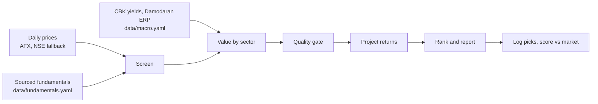

# NSE market agent

An autonomous, rule-based agent that screens Nairobi Securities Exchange (Kenya) stocks, values them, flags undervalued
names, projects return ranges and tracks how its past picks performed. It runs on GitHub Actions and publishes a weekly
report to GitHub Pages.

**Live report:** https://ronaldndirangu.github.io/nse-market-agent/

> **Not financial advice.** This project is a research tool built from public data and fixed rules. Figures can be
> wrong, late or incomplete. Verify everything against company filings and speak to a licensed adviser before investing.

## How it works

Every number comes from deterministic Python code. No AI or paid API runs anywhere in the pipeline, and the report is
rendered from a template.



1. **Screen.** A stock needs a fresh price, average daily turnover of at least KES 1m, at least 3 sourced annual
   periods, positive EPS and no suspension.
2. **Value.** Cost of equity is `ke = (10y KES yield - sovereign default spread) + beta x mature ERP + country risk
   premium`, which is about 20% at beta 1. Beta comes from 3 years of weekly returns against an equal-weight index of
   the universe. Models:
   - Banks: justified P/B `(ROE - g) / (ke - g)`.
   - Dividend payers: Gordon growth `D1 / (ke - g)`.
   - Everyone: sector-relative P/E and P/B (when at least 3 peers exist) and the Graham number.
   - Growth `g` is sustainable growth `ROE x retention`, capped at 7%.
3. **Agree.** A stock counts as undervalued only when at least half of its models (and at least 2) put fair value 15%
   or more above the price.
4. **Quality gate.** Piotroski F-score (banks skip the margin and liquidity signals), Altman Z'' for non-financials,
   NPL ratio level and trend for banks, and profit-warning keywords in NSE announcements over the last 180 days.
5. **Project.** Annual return `= net dividend yield + (1 + g) x (V/P)^(1/3) - 1 - round-trip costs / 3`, using 1.82%
   trading costs per side and 5% dividend withholding tax. Bear and bull cases use the low and high fair values and
   shift growth by 2 points.
6. **Rank.** A weighted composite of z-scores: 50% margin of safety, 30% quality, 20% momentum.
7. **Buy rule.** `BUY` means undervalued, passes quality, and the base-case return beats the net 91-day T-bill yield
   by at least 5 points. `PICK` is undervalued without clearing that hurdle. `WATCH` means the models agree but a screen
   or quality check failed.

All thresholds live in [`data/settings.yaml`](data/settings.yaml).

## Schedule

| Workflow | When (UTC) | What it does |
| --- | --- | --- |
| Daily prices | 13:00 Mon to Fri (16:00 EAT) | Records closing prices and NASI, commits `data/` |
| Results watch | 13:30 Mon to Fri | Detects results announcements, extracts figures by rule, opens a review PR |
| Weekly report | 14:00 Friday | Values and ranks, runs simulation, backtest and scorecard, commits `reports/`, deploys Pages, opens an issue |
| Monthly scorecard | 15:00 on the 1st | Scores every logged pick against the market |
| CI | Every push and PR | Runs the test suite |

Every workflow also runs on demand from the Actions tab. GitHub pauses schedules in a public repo after 60 days with no
activity; the daily and weekly commits keep it active.

## Data and integrity

| Data | Source | File |
| --- | --- | --- |
| Daily prices, volume | [afx.kwayisi.org/nse](https://afx.kwayisi.org/nse/), fallback [nse.co.ke](https://www.nse.co.ke/) | `data/prices/*.csv` |
| NASI | AFX index page, recorded daily from the first run | `data/nasi.csv` |
| Fundamentals | Company annual and interim reports | `data/fundamentals.yaml` |
| T-bills, CBR, inflation | [Central Bank of Kenya](https://www.centralbank.go.ke/) | `data/macro.yaml` |
| Equity and country risk premium | [Damodaran](https://pages.stern.nyu.edu/~adamodar/) | `data/macro.yaml` |
| Announcements | NSE announcements feed | `data/market/` |

Rules:

- Fundamentals are never invented. Every period in `data/fundamentals.yaml` carries a `source_url`, a reporting period
  and a publication date. A missing figure stays missing and appears under **Data gaps** in the report.
- No LLM extracts fundamentals. The results watcher parses filings with fixed rules (bank results follow the CBK
  prescribed format) and writes candidates to `data/results_queue.yaml` on the `results-review` branch. A person checks
  each figure against the filing, copies it into `data/fundamentals.yaml` and merges the PR. Nothing merges itself.
- Backtests only use fundamentals published on or before each test date, so they avoid look-ahead bias.

### Fundamentals format

Amounts are in KES millions, per-share values in KES, ratios as decimals and shares in millions.

```yaml
companies:
  KCB:
    periods:
      - period: FY2025
        period_end: "2025-12-31"
        published: "2026-03-26"
        type: annual
        source_url: https://...
        values: {eps: 19.0, bvps: 75.0, dps: 3.0, roe: 0.22, npl_ratio: 0.18}
```

## Reports

- `reports/latest.md`: ranked picks, fair-value ranges, bear/base/bull returns, risks, confidence and data gaps.
- `reports/simulation.md`: Monte Carlo (block bootstrap of weekly returns) for 1, 3 and 5 years, plus replays of the
  2016 rate-cap shock, the 2020 COVID crash and the 2023 sell-off.
- `reports/backtest.md`: point-in-time walk-forward test of the rules against the equal-weight market.
- `reports/scorecard.md`: every logged pick (`data/picks.csv`) scored against the market since the pick date.

## Run it locally

```powershell
python -m venv .venv
.\.venv\Scripts\pip install -r requirements.txt
.\.venv\Scripts\python -m nse_agent weekly --no-fetch
```

| Command | Purpose |
| --- | --- |
| `daily` | Record today's prices and NASI |
| `backfill` | One-time price history backfill (slow: AFX asks for a 60 second crawl delay) |
| `refresh` | Refresh company pages for volume and liquidity |
| `weekly [--no-fetch]` | Value, rank and write the report |
| `simulate [--paths N]` | Monte Carlo projection of current picks |
| `backtest [--top N]` | Walk-forward backtest |
| `score` | Score logged picks |
| `review` | Review your own holdings |
| `results-watch` | Queue new results for review |
| `mcp` | Run the MCP server |

### Review your holdings

Copy `portfolio.example.yaml` to `portfolio.yaml` and run `python -m nse_agent review`. `portfolio.yaml` is gitignored
so your holdings stay on your machine.

### Use it from Copilot or another MCP client

```powershell
.\.venv\Scripts\pip install -e ".[mcp]"
.\.venv\Scripts\python -m nse_agent mcp
```

Tools: `screen_stocks`, `run_valuation`, `get_fundamentals`, `get_announcements`.

## Tests

```powershell
.\.venv\Scripts\python -m pytest -q
```

## Limits

- The 16-stock universe covers the most liquid counters. Add more in `data/universe.yaml` along with sourced
  fundamentals.
- AFX does not publish NASI history, so NASI comparisons start from the first daily run. The scorecard and backtest use
  an equal-weight index of the universe until then.
- Either price source may block GitHub runner IPs. The daily job fails visibly when both do.
- Capital gains tax is not modelled.
- The cost of equity is high (about 20% at beta 1: the 10-year Kenyan bond yield less the default spread, plus beta x
  ERP plus the country risk premium). Gordon and earnings-power values are conservative as a result, so most counters
  show a negative margin of safety. Change `data/macro.yaml` to test other assumptions.
- Insurers (Britam, Jubilee, CIC, Kenya Re) are not valued. They need an embedded-value model.

### Known data issues

- AFX price history is not adjusted for corporate actions. I&M bonus issues on 2019-05-13 and 2021-05-11 show as price
  drops.
- Two one-day spikes over 40% decay within days: IMH on 2024-08-21 and KPLC on 2024-10-29. They are kept as published
  and can inflate volatility, beta and backtest returns around those dates.
- Most `published` dates are the CMA filing deadline, not the exact release date (see `published_basis`).
- Company-specific caveats (proposed dividends, unaudited interims, OCR'd figures, omitted lines) are listed under
  `gaps` in `data/fundamentals.yaml` and repeated in each report's **Data gaps** section.
