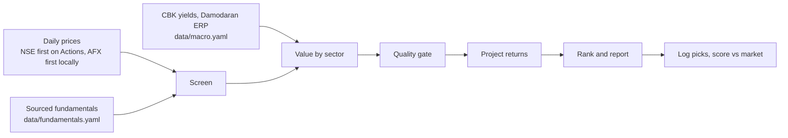

# NSE market agent

An autonomous, rule-based agent that screens Nairobi Securities Exchange (Kenya) stocks, values them, flags undervalued
names, projects return ranges and tracks how its past picks performed. It runs on GitHub Actions and publishes a weekly
report to GitHub Pages.

**Live dashboard:** https://ronaldndirangu.github.io/nse-market-agent/ (daily brief at `daily.html`, weekly report at
`weekly.html`, all past reports at `archive.html`)

**Reading routine:** check Data health, read today's conclusion, then scan changes and the Buy/Watch candidates.
Open a stock for its risk drivers, failed checks and source filing. Use the weekly report for a deeper review.
Avoid means failing this model's entry checks; it is not an automatic instruction to sell existing holdings.
Subscribe through `feed.xml` for daily briefs and material changes, or follow the `daily-alert` issue on GitHub.

The interface combines Airbnb-inspired spacing and neutral surfaces with Fluent-style blue actions.
Green and amber highlight meaningful status, while risk and comparison data retain their semantic colors, consistent with
[Fluent's neutral and semantic color guidance](https://fluent2.microsoft.design/color).
The main verdict pairs color with text and an icon: green means Buy rules passed, red means no qualifying Buy,
amber means verify an incomplete assessment, and gray means live evidence is unverified. Watch stocks use amber.
Green does not imply low risk or guaranteed profit; red is not an automatic instruction to sell.
It uses original assets and system fonts, not Airbnb logos or proprietary typography.
Explicit `?scoutTheme=light` and `?scoutTheme=dark` selections carry through internal page navigation.

The dashboard separates the daily decision from advanced research. It includes a compact benchmark comparison,
summary counts, stock review cards, a changes sidebar and a searchable, tier-filtered stock table. Mobile navigation,
native keyboard controls, visible focus indicators and touch-sized primary actions work across the report pages.
The numerical rules, entry tiers and projections are unchanged by these interface controls.

The interface follows [GOV.UK mobile-first layout guidance](https://design-system.service.gov.uk/styles/layout/),
[progressive disclosure](https://www.nngroup.com/articles/progressive-disclosure/) and the W3C guidance for
[320 CSS-pixel reflow](https://www.w3.org/WAI/WCAG22/Understanding/reflow.html),
[visible keyboard focus](https://www.w3.org/WAI/WCAG22/Understanding/focus-visible.html) and
[pointer target sizes](https://www.w3.org/WAI/WCAG22/Understanding/target-size-minimum.html).
Primary controls target 44 pixels; compact sorting controls meet the 24-pixel minimum. Detailed data tables scroll
within their own containers rather than widening the page.

> **Not financial advice.** This project is a research tool built from public data and fixed rules. Figures can be
> wrong, late or incomplete. Verify everything against company filings and speak to a licensed adviser before investing.

## How it works

Every number comes from deterministic Python code. No AI or paid API runs anywhere in the pipeline, and the report is
rendered from a template.



1. **Screen.** A stock needs a fresh price, average daily turnover of at least KES 1m, at least 3 sourced annual
   periods, positive EPS, no suspension and no overdue annual results (latest period ended within 540 days).
2. **Value.** Cost of equity is `ke = (10y KES yield - sovereign default spread) + beta x mature ERP + country risk
   premium`, which is about 20% at beta 1. Beta comes from 3 years of weekly returns against an equal-weight index of
   the universe. Models:
   - Banks: justified P/B `(ROE - g) / (ke - g)`.
   - Dividend payers: Gordon growth `D1 / (ke - g)`.
   - Positive earners: earnings power `3-year average EPS / ke`.
   - Everyone: sector-relative P/E and P/B when at least 3 peers exist.
   - Growth `g` is sustainable growth `ROE x retention`, capped at 7%.
   - The Graham number is shown for reference only. It does not count toward fair value or the vote.
3. **Agree.** A stock counts as undervalued only when at least half of its models (and at least 2) put fair value 15%
   or more above the price. When the highest model value is more than 3 times the lowest, the models disagree too much
   to trust, and the stock is Avoid.
4. **Quality gate.** Piotroski F-score (banks swap the margin and liquidity signals for cost-to-income and core
   capital trends and skip leverage, since deposits dominate bank liabilities), Altman Z'' for non-financials,
   NPL ratio level and trend for banks, and profit-warning keywords in NSE announcements over the last 180 days.
5. **Project.** Annual return `= net dividend yield + (1 + g) x (V/P)^(1/3) - 1 - round-trip costs / 3`, using 1.82%
   trading costs per side and 5% dividend withholding tax. Bear and bull cases use the low and high fair values and
   shift growth by 2 points.
6. **Rank.** A weighted composite of z-scores: 40% momentum, 30% dividend yield, 20% quality and 10% margin of
   safety. A stock missing a signal has its other weights scaled up to the same total. The rank orders stocks by these
   signals and is not a buy order: a stock ranked #1 can still be Avoid. Only the tier says whether to buy.
7. **Tier.** `Buy` means undervalued (enough models agree and they are not dispersed), passes the screen and the
   quality gate, and the base-case return beats the hurdle: the net 364-day T-bill yield plus 5 points. `Watch` passes
   quality and misses exactly one other threshold. Everything else is `Avoid`. The CLI table also marks `PICK` for a
   stock that is undervalued but misses the hurdle.

All thresholds live in [`data/settings.yaml`](data/settings.yaml).

### Strict checks and risk profile

A stock is marked **Strict checks passed** only when all four stricter gates pass:

| Gate | Rule |
|---|---|
| Valuation | At least 3 valuation models put fair value 15% or more above the price |
| Quality | Quality gate passes with a score of 0.67 or more |
| Screen | Liquid, fresh price, at least 3 sourced periods, results not overdue, positive EPS, not suspended |
| Return | Base-case annual return beats the Buy hurdle |

When nothing qualifies, the brief lists the closest candidates and the gates they miss.

Live flags also require current critical evidence and assessed risk inputs. Missing information is shown as
**Insufficient data** or an **incomplete** assessment, never as an unqualified Low risk. Historical reconstructions
do not apply today's feed health because historical fetch-health records do not exist. Agreement of methods is not
a measured probability of profit.

Every stock also gets a **risk profile**. Seven factors are each rated Low, Moderate or High from fixed thresholds:
volatility, beta, liquidity, downside (bear case), valuation spread (fair high over fair low), balance sheet (bank NPL
ratio or Altman Z) and events (profit warnings, suspensions). Overall risk is High when the balance sheet or events
factor is High or two factors are High, Moderate when one factor is High or three are Moderate, and Low otherwise.
The numerical risk level never changes the flag; incomplete evidence can hold a live flag back.
Missing inputs are listed as not assessed.

Point-in-time backtest of the flag since 2017: it fired 28 times, only on COOP, EQTY and KCB. At 12 months no flagged
pick lost money, but they trailed the equal-weight universe by 3.5% on average (N=18); at 6 months they beat it by
4.5% (N=23). The plain Buy tier did better at 12 months (+8.9%). The flag is a stricter filter, and its short record does not yet beat
the Buy tier.

## Schedule

| Workflow | When (UTC) | What it does |
| --- | --- | --- |
| Daily brief | 13:07 Mon to Fri (16:07 EAT) | Records closing prices, writes Buy/Watch candidates and changes, logs the first verified daily prediction, publishes Pages, and alerts only on a material change |
| Results watch | 13:30 Mon to Fri | Detects results announcements, extracts figures by rule, opens a review PR |
| Weekly report | 14:07 Friday | Saves and publishes the core report first. Simulation, backtest, scorecard and retrospective run separately; failed analytics or notifications remain visible without blocking the core publication |
| Monthly scorecard | 15:00 on the 1st | Scores every logged pick against the market, refreshes the retrospective and the weight test, and opens a `tune-weights` PR only when new weights win out of sample. Weights never change without your merge |
| Publish site | Called after saved reports, or on demand | Checks out current main, rebuilds and validates the committed snapshot, then deploys through one shared Pages concurrency group |
| Publication freshness | 14:37 Mon to Fri (17:37 EAT) | Checks the deployed report for a missed update or stale critical evidence |
| CI | Every code push and PR | Runs tests and validates the generated site |

Every workflow also runs on demand from the Actions tab. GitHub pauses schedules in a public repo after 60 days with no
activity; the daily and weekly commits keep it active.
Schedules are best effort and can be delayed by GitHub. The freshness monitor shares that scheduling service, so it
does not provide an independent uptime guarantee. Notifications are separate from successful site publication.

### Publication and evidence health

- Actions tries NSE first; local collection keeps AFX first. A response covering less than half the universe is
  rejected. Official prediction logging requires verified current closing prices for every non-suspended counter,
  so a partial response cannot freeze the day's first prediction.
- `data/market/health.json` records fetch attempts, failures and last successes. An empty announcement parse is a
  failed check and does not advance the successful-check date.
- The expected session is the last weekday whose close plus a one-hour buffer has passed, in EAT. A lag of one to
  three weekdays is Delayed (public holiday or source lag); longer lags are Stale. No holiday calendar is assumed.
- Announcement checks have a one-weekday freshness budget. Bill rates have a 9-calendar-day budget;
  curated bond, premium and tax assumptions need review after 14 calendar days.
  Fundamentals retain the existing 540-day annual-period screen. Per-stock dates remain visible.
- A browser warning appears after the next expected update time, even if a workflow never starts. It does not
  refresh data. `status.json` exposes the same dated assessment for the publication monitor.
- Each new daily report has an immutable JSON revision under `reports/daily/snapshots/` and a `manifest.json`.
  The manifest links to the first official ledger rows by checksum. Same-day revisions show differences without
  rewriting or duplicating prediction rows. Existing historical predictions remain unchanged.
  Older archived reports retain their original wording and should not be read as current assessments.
- The publisher rebuilds from main after data pushes and rejects broken panels, internal links, anchors or revision
  checksums. A failed data push cannot deploy its uncommitted artifact. Concurrent data writes can still conflict;
  that failure remains visible and requires a rerun rather than overwriting another workflow's data.

## Data and integrity

| Data | Source | File |
| --- | --- | --- |
| Daily prices, volume | [afx.kwayisi.org/nse](https://afx.kwayisi.org/nse/), fallback [nse.co.ke](https://www.nse.co.ke/) | `data/prices/*.csv` |
| NASI | Month-end closes from 2016 in [CMA](https://www.cma.or.ke/) quarterly statistical bulletins (CBK weekly bulletin for the latest month), plus the AFX index page daily when reachable | `data/nasi.csv`, sources in `data/nasi_sources.csv` |
| Dividends | Company notices, CMA bulletins and annual reports, from 2016 | `data/dividends.yaml` |
| Bonus issues, splits, rights, mergers | NSE and company notices | `data/corporate_actions.yaml` |
| Fundamentals | Company annual and interim reports | `data/fundamentals.yaml` |
| T-bill accepted-bid rates | [CBK results](https://www.centralbank.go.ke/bills-bonds/treasury-bills/) | Automatic `data/official/cbk/`, curated fallback in `data/macro.yaml` |
| Observed CPI inflation | [KNBS monthly releases](https://www.knbs.or.ke/) | Automatic `data/official/knbs/`, dated reviewed fallback |
| Bond yield, CBR and other assumptions | Sources recorded per input | Curated `data/macro.yaml`; never refreshed by a bill auction |
| Equity and country risk premium | [Damodaran](https://pages.stern.nyu.edu/~adamodar/) | `data/macro.yaml` |
| Announcements | NSE announcements feed | `data/market/` |

Rules:

- Fundamentals are never invented. Every period in `data/fundamentals.yaml` carries a `source_url`, a reporting period
  and a publication date. A missing figure stays missing and appears under **Data gaps** in the report.
- No LLM extracts fundamentals. The results watcher parses filings with fixed rules (bank results follow the CBK
  prescribed format) and writes candidates to `data/results_queue.yaml` on the `results-review` branch. A person checks
  each figure against the filing, copies it into `data/fundamentals.yaml` and merges the PR. Nothing merges itself.
- Backtests only use fundamentals published on or before each test date, so they avoid look-ahead bias.

### Fundamentals format

Amounts are in KES millions, per-share values in KES, ratios as decimals and shares in millions.

```yaml
companies:
  KCB:
    periods:
      - period: FY2025
        period_end: "2025-12-31"
        published: "2026-03-26"
        type: annual
        source_url: https://...
        values: {eps: 19.0, bvps: 75.0, dps: 3.0, roe: 0.22, npl_ratio: 0.18}
```

## Reports

The Pages site opens on a daily decision brief: evidence health, today's conclusion, changes, and Buy/Watch cards.
Avoid stocks stay in collapsed research views. Each stock opens a detail page with its source filing, gates and risk
profile. The reconstructed track record, signal evidence and full ranking remain available under expandable sections. Every
Markdown report below is also rendered as a page, with dated archives for the daily brief and weekly report.
The track record starts with the extra historical return over an equal-weight covered-stock basket, the selected-stock
beat rate, and scenario coverage. The beat rate is stock-level outperformance, not a probability of profit.
Historical 12-month holding tests, the separate monthly-rotation chart, and actual live outcomes are labelled separately.
The dedicated Track record page starts with this same plain-language summary and keeps the full technical report collapsed.
Candidate cards use the available width. Changes, alerts and the reading guide form a separate responsive row rather
than a tall sidebar. Rates and inflation use a full-width summary with expandable sources and assumptions.
Stock search is available at the top of every page. Stock reviews follow **Verdict, Why, What would change it,
What to verify next**, with recorded company notices and filing caveats beside the decision.
The conditional price is the valuation-cushion threshold with every model estimate held fixed, not a price target
or an automatic Buy. Missing or disagreeing valuations do not produce a price trigger. Return drivers explain
regular dividends after tax, assumed business growth, closing the valuation gap (including the growth interaction),
and annualised trading costs. They sum to the unchanged middle-case return.
The research score ranks every stock independently of Buy/Watch/Avoid. The main table groups stocks by entry verdict;
research-score order is a separate expandable view. Its historical track record does not validate the entry rules.
Strict checks are explicitly separate from entry checks and are not a probability of profit. Risk labels remain
visible in neutral styling, with incomplete assessments identified separately. Stored ledger fields and tier rules
are unchanged; older reports retain their original wording.
`reports/daily/latest.json` is the machine-readable snapshot behind the dashboard.
Disagreeing or insufficient valuation methods suppress point estimates in consumer reports and alerts. Raw outputs
remain in the ledger and MCP tools with `estimate_reliable` metadata. Returns are illustrative scenarios, not loss
limits or probability bands; the T-bill rollover example assumes today's rate stays unchanged.

- `reports/daily/YYYY-MM-DD.md` and `reports/daily/latest.md`: the daily brief. Strict-rule flags with risk
  profiles, then up to five Buy/Watch candidates with score contributions and the binding constraint.
  Avoid stocks remain in the full research ranking.
- `data/rankings/live/YYYY-MM.csv`: the append-only prediction ledger. Every stock, every day: composite score, each
  signal's value and contribution, tier, risk level, high confidence flag, bear/base/bull projections and the code SHA.
  Past rows are never edited.
- `data/rankings/reconstructed.csv`: the engine rerun point in time on every month start, using only prices and
  fundamentals published by that date.
- `reports/retrospective.md`: how well past rankings predicted. The forward scorecard scores the top 5 and the full
  ranking at 1, 3, 6 and 12 months on total return against the equal-weight universe and NASI (hit rate, excess
  return, Spearman rank IC and bear-bull band calibration). Reverse attribution takes each month's actual top 5
  performers, shows the rank the engine gave them, which signals flagged them, and classifies each miss as an event,
  missing data, a turnaround, macro or a signal miss. A per-signal IC table shows which signals carry information.
- `reports/tuning.md`: walk-forward test of the ranking weights. On each month start it picks the weights (0.1 grid over
  margin of safety, quality, momentum and dividend yield) with the best mean 3-month IC using only windows that had
  matured by that date, then scores the next month's top 5 out of sample at 3 and 12 months against the current
  weights. It recommends new weights only when they beat the current ones on IC and excess return at both horizons.
- `reports/latest.md`: ranked picks, fair-value ranges, bear/base/bull returns, risks, confidence and data gaps.
- `reports/simulation.md`: Monte Carlo (block bootstrap of weekly returns) for 1, 3 and 5 years, plus replays of the
  2016 rate-cap shock, the 2020 COVID crash and the 2023 sell-off.
- `reports/backtest.md`: point-in-time walk-forward test of the rules against the equal-weight market.
- `reports/scorecard.md`: every logged pick (`data/picks.csv`) scored against the market since the pick date.

## Run it locally

```powershell
python -m venv .venv
.\.venv\Scripts\pip install -r requirements.txt
.\.venv\Scripts\python -m nse_agent weekly --no-fetch
```

| Command | Purpose |
| --- | --- |
| `daily` | Record today's prices and NASI |
| `backfill` | One-time price history backfill (slow: AFX asks for a 60 second crawl delay) |
| `refresh` | Refresh company pages for volume and liquidity |
| `weekly [--no-fetch]` | Value, rank and write the report |
| `brief [--no-fetch] [--no-prices]` | Daily brief and ledger append |
| `reconstruct` | Rebuild the point-in-time reconstructed ledger |
| `retro [--no-rebuild]` | Forward scorecard, per-signal IC and reverse attribution |
| `tune-weights [--proposal-file F] [--body-file F]` | Walk-forward weight test; writes a proposal only when it wins out of sample |
| `apply-weights F` | Write a proposal's weights into `data/settings.yaml` (used on the PR branch) |
| `simulate [--paths N]` | Monte Carlo projection of current picks |
| `backtest [--top N]` | Walk-forward backtest |
| `score` | Score logged picks |
| `review` | Review your own holdings |
| `results-watch` | Queue new results for review |
| `site [--check]` | Rebuild static pages and optionally validate links, panels and revision provenance without fetching data |
| `check-published [--url URL]` | Check deployed report freshness and critical evidence |
| `mcp` | Run the MCP server |

### Review your holdings

Copy `portfolio.example.yaml` to `portfolio.yaml` and run `python -m nse_agent review`. `portfolio.yaml` is gitignored
so your holdings stay on your machine.

### Use it from Copilot or another MCP client

```powershell
.\.venv\Scripts\pip install -e ".[mcp]"
.\.venv\Scripts\python -m nse_agent mcp
```

Tools: `screen_stocks`, `run_valuation`, `get_fundamentals`, `get_announcements`.

## Tests

```powershell
.\.venv\Scripts\python -m pytest -q
```

## Official-source enrichment

Daily briefs and fetched weekly reports collect accepted-bid Treasury-bill rates directly from CBK result PDFs and
observed CPI inflation from the dated KNBS monthly release. `python -m nse_agent enrich` refreshes these independently.
Validated facts are saved under `data/official/`, one immutable record per release; attempt status and errors go in
`data/market/health.json`. Raw PDFs are not committed. Changed releases require human review.

The 364-day rate feeds the after-tax T-bill comparison and Buy hurdle. Inflation adds purchasing-power context using
the Fisher calculation, with an explicit unchanged-inflation assumption; it does not change ranking weights.
Reports and daily JSON snapshots retain the exact macro inputs used, source URLs and dates.
CBK's signed release date is separate from the future issue date. Missing accepted tenors retain their previous
dated value. Critical health checks distinguish bill rates (9 days) from curated assumptions (14 days).
Collecting a bill rate never refreshes the 10-year bond, equity premium or tax assumptions.

`--no-fetch`, analysis and site builds make no source requests. Reconstructed backtests still deliberately use current
rates, as disclosed; date-bounded live analyses cannot use newly collected releases from a future observation date.
Reviewed company figures stay in `data/fundamentals.yaml`. Results notices, including same-host HTML-to-PDF links,
produce review candidates only. A pending notice is checked against known periods and source documents before it
holds back strong-confidence flags; `queued` alone is not proof of unreviewed figures. Mark resolved ambiguous or
restated notices `reviewed` after checking their source. Company discovery dates are not historical publication dates.

The dashboard's Rates and inflation panel explains the inputs and remaining assumptions. Licensed ICE pricing is
not connected: access credentials and public raw/derived-data redistribution rights must be confirmed first.

## Limits

- The 16-stock universe covers the most liquid counters. Add more in `data/universe.yaml` along with sourced
  fundamentals.
- NASI history is month-end only before the daily runs began, so NASI comparisons use the last month-end close on or
  before each window's start and end dates.
- AFX is unreachable from GitHub-hosted runners (IPv4 connections time out), so scheduled runs take prices and volume
  from the NSE ticker API, record no NASI level, and keep AFX company stats from the last local `refresh`. There is
  still no independent runner-reachable price provider. The HTTP client honours Retry-After with bounded jittered
  backoff (up to 60 seconds) and skips unreachable hosts for the rest of a process. The daily job fails visibly when
  no closing snapshot is available, while saved degraded reports can still publish with explicit health warnings.
- Capital gains tax is not modelled.
- The cost of equity is high (about 20% at beta 1: the 10-year Kenyan bond yield less the default spread, plus beta x
  ERP plus the country risk premium). Gordon and earnings-power values are conservative as a result, so most counters
  show a negative margin of safety. Change `data/macro.yaml` to test other assumptions.
- Insurers (Britam, Jubilee, CIC, Kenya Re) are not valued. They need an embedded-value model.

### Known data issues

- AFX price history is not adjusted for corporate actions. The engine applies the bonus and split factors in
  `data/corporate_actions.yaml` (for example I&M on 2019-05-13 and 2021-05-11) before computing momentum, volatility,
  beta and every return. Backtest, scorecard, retrospective and tuning returns also add net dividends.
- Dividends announced before mid-2019 often lack a sourced book-closure or payment date. For those rows the engine uses
  the `announced` date as the ex date, which can be up to about two months early. Dividends between mid-2019 and early
  2021 are mostly unsourced; when a trailing 12-month window has no sourced dividend, the yield falls back to the
  latest reported DPS. Unsourced rows are listed under `gaps` in `data/dividends.yaml`.
- CMA prints NASI 161.35 for July 2017, above the daily highs in the CBK weekly bulletin; it is kept and flagged in
  `data/nasi_sources.csv`.
- Two one-day spikes over 40% decay within days: IMH on 2024-08-21 and KPLC on 2024-10-29. They are kept as published
  and can inflate volatility, beta and backtest returns around those dates.
- Most `published` dates are the CMA filing deadline, not the exact release date (see `published_basis`).
- Company-specific caveats (proposed dividends, unaudited interims, OCR'd figures, omitted lines) are listed under
  `gaps` in `data/fundamentals.yaml` and repeated in each report's **Data gaps** section.
